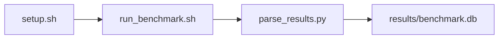

# multichase Pointer-Chase Benchmark

[](LICENSE)
[](.github/workflows/ci.yml)

Target: Ubuntu 26.04 · NVIDIA · see Hardware Requirements. This is a host benchmark, not a laptop `pip install` project.

## Quick Start

```bash
git clone https://github.com/garys-gpu-benchmarks/409-sys-bench-nvidia-multichase-numa-latency-ubu2604.git
cd 409-sys-bench-nvidia-multichase-numa-latency-ubu2604
sudo bash setup.sh --assume-yes
bash run_benchmark.sh --profile smoke --validate
```
Results are written to `results/benchmark.db` and `results/summary.json`.

This workload is executed on the validation host after the repository is copied there. `setup.sh` and `run_benchmark.sh` do not open an outbound SSH session.

Prerequisites: Ubuntu 26.04; NVIDIA; Python 3.14.4; root or sudo for `setup.sh`. Framework: Bash, SQLite, Python, PyYAML, C (not C++), GCC, numactl. This is a host benchmark, not a laptop `pip install` project.



## 1. Overview

scripts/collect_workload.py dispatches scripts/collect_multichase.py, which compiles src/multichase.c with gcc -O2 -std=c11 and runs one pointer-chase per yaml working-set tier. working_set_size: comma-separated tier=bytes (smoke l1=16384,l2=262144,l3=2097152,local_dram=16777216,remote_dram=16777216; baseline/extended l1=32768,l2=262144,l3=8388608,local_dram=268435456,remote_dram=268435456). stride: chase stride. num_threads: recorded in CSV. Sweep dimensions: num_numa_nodes, num_threads, thread_affinity, page_size, working_set_size, stride, access_pattern, prefetch_enabled.

## 2. What It Validates

- Validates at least two finite latency_ns rows from collect_multichase.py. remote_dram uses numactl --membind=1 when numactl reports two or more NUMA nodes; on a single-node host it is reported as not measured
- #1: Pointer-chase latency for the L1-cache tier (latency_ns_l1); is present and physically sensible.
- #2: Pointer-chase latency for the L2-cache tier (latency_ns_l2); is present and physically sensible.
- #3: Pointer-chase latency for the L3-cache tier (latency_ns_l3); is present and physically sensible.
- #4: Local DRAM latency, ns (latency_ns_local_dram); is present and physically sensible.
- #5: Remote DRAM latency, ns (latency_ns_remote_dram) is present and physically sensible.

## 3. Metrics Captured

- **#1: Pointer-chase latency for the L1-cache tier** — stored as `latency_ns_l1`.
- **#2: Pointer-chase latency for the L2-cache tier** — stored as `latency_ns_l2`.
- **#3: Pointer-chase latency for the L3-cache tier** — stored as `latency_ns_l3`.
- **#4: Local DRAM latency, ns** — stored as `latency_ns_local_dram`.
- **#5: Remote DRAM latency, ns** — stored as `latency_ns_remote_dram`.

## 4. Hardware Requirements

### Supported environment

- OS: Ubuntu 26.04
- GPU vendor: NVIDIA
- Framework family: Bash, SQLite, Python, PyYAML, C (not C++), GCC, numactl
- Python: Python 3.14.4

### Reference validation environment

The tables below describe the machine used to generate the reference results. They are not a requirement that every user buy that exact cloud instance.

### System

scripts/collect_workload.py dispatches scripts/collect_multichase.py, which compiles src/multichase.c with gcc -O2 -std=c11 and runs one pointer-chase per yaml working-set tier. working_set_size: comma-separated tier=bytes (smoke l1=16384,l2=262144,l3=2097152,local_dram=16777216,remote_dram=16777216; baseline/extended l1=32768,l2=262144,l3=8388608,local_dram=268435456,remote_dram=268435456). stride: chase stride.

### GPU

Ubuntu 26.04 / NVIDIA / Bash, SQLite, Python, PyYAML, C (not C++), GCC, numactl

## 5. Software Requirements

| Component | Version |
|---|---|
| OS | Ubuntu 26.04 |
| Kernel | kernel 7.0.0 |
| Python | Python 3.14.4 |
| ROCm | CUDA 13.3 |
| rocBLAS | N/A - rocBLAS not used |

scripts/collect_workload.py dispatches scripts/collect_multichase.py, which compiles src/multichase.c with gcc -O2 -std=c11 and runs one pointer-chase per yaml working-set tier. working_set_size: comma-separated tier=bytes (smoke l1=16384,l2=262144,l3=2097152,local_dram=16777216,remote_dram=16777216; baseline/extended l1=32768,l2=262144,l3=8388608,local_dram=268435456,remote_dram=268435456). stride: chase stride.

## 6. Installation

```bash
Compile multichase.c with gcc -O2 -std=c11 via collect_multichase.py; always prefix numactl --cpunodebind=0 and --membind=0 or 1
```

## 7. Running the Benchmark

```bash
Compile multichase.c with gcc -O2 -std=c11 via collect_multichase.py; always prefix numactl --cpunodebind=0 and --membind=0 or 1
```

**Validating results separately:**

```bash
export BENCHMARK_PYTHON=/usr/bin/python3.13  # optional
python3 -m venv .venv
source ".venv/bin/activate"
".venv/bin/python" scripts/validate_results.py
```

## 8. Output

### `results/benchmark.db` (SQLite)

CSV with one row per cache or DRAM tier

sample_index,status,tier,latency_ns,working_set_size,stride,thread_count,error_message
0,ok,l1,1.2,32768,64,1,

```bash
Compile multichase.c with gcc -O2 -std=c11 via collect_multichase.py; always prefix numactl --cpunodebind=0 and --membind=0 or 1
```

### `results/summary.json`

Consolidated metrics from the most recent run — suitable for CI artifact upload or dashboard ingestion.

### `results/raw/<timestamp>.txt`

CSV with one row per cache or DRAM tier

sample_index,status,tier,latency_ns,working_set_size,stride,thread_count,error_message
0,ok,l1,1.2,32768,64,1,

## 9. Baselines / Thresholds

Expected ranges and gates live in `config/benchmark_config.yaml` under `baselines:` or `thresholds:`. To update them, edit that file — never edit validation code directly.

## 10. Troubleshooting

**`setup.sh` missing collector**
Create cannot finish without `scripts/collect_workload.py`.

**`self_check` overlay rewritten**
Do not overwrite files listed in `results/overlay_lock.json`.

**Remote SSH drop during setup**
Reconnect and resume `bash setup.sh --assume-yes`. Do not wipe `.venv` or `.cache`.

## 11. NVIDIA H100 Coding Differences

Native NVIDIA CUDA workload. Execute on the stated Ubuntu release with the host NVIDIA driver and CUDA userspace. ROCm porting notes do not apply.

## Repository layout

```text
.
├── setup.sh
├── run_benchmark.sh
├── benchmark_specification.json
├── config/
├── scripts/
├── src/
├── tests/
├── docs/
├── results/
└── LICENSE
```
